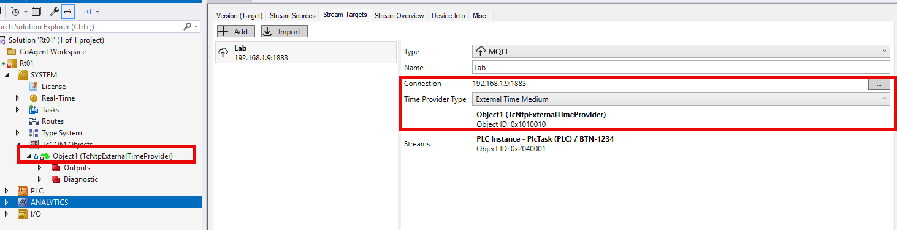
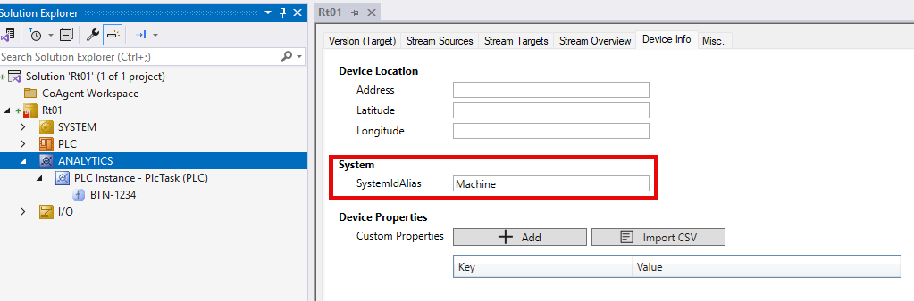
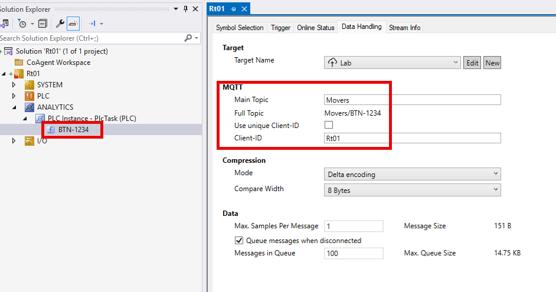
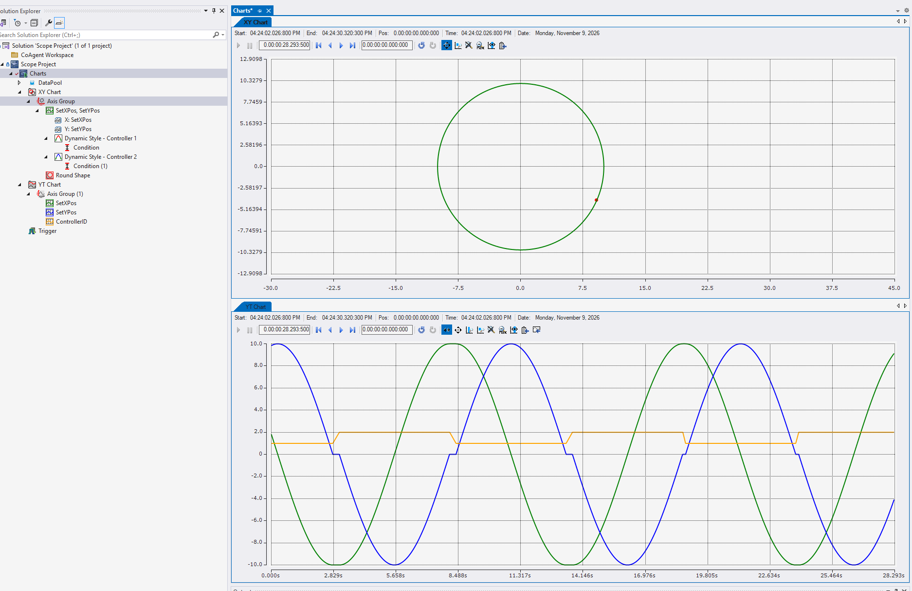

# Analytics Logger – Shared Topic Across Two Controllers

Two TwinCAT runtimes hand a mover back and forth. Each runtime has its own TwinCAT Analytics Logger, and both loggers publish the same PLC struct to **one** MQTT topic. Publishing is conditional (only while the mover carries BTN `1234`), so whichever controller currently owns the mover is the only one writing, and the broker ends up with one continuous record of the mover regardless of which PC it was on. The Scope project subscribes to that single topic and draws the whole circle.

This sample is created by [Beckhoff Automation LLC.](https://www.beckhoff.com/en-us/), and is provided as-is under the Zero-Clause BSD license.

## Disclaimer

All sample code provided by Beckhoff Automation LLC are for illustrative purposes only and are provided "as is" and without any warranties, express or implied. Actual implementations in applications will vary significantly. Beckhoff Automation LLC shall have no liability for, and does not waive any rights in relation to, any code samples that it provides or the use of such code samples for any purpose.

## Repository layout

| Path | Contents |
| --- | --- |
| `Rt01/` | TwinCAT project for controller 1 (`Rt01.sln`). Target `192.168.1.27.1.1`. |
| `Rt02/` | TwinCAT project for controller 2 (`Rt02.sln`). Target `192.168.1.25.1.1`. |
| `SharedTypes.tmc` | `ST_Mover` – the struct both PLCs log. Referenced by both projects as an additional TMC file so the layout is byte-identical on both targets. |
| `Scope Project/` | TwinCAT Scope project (`Charts.tcscopex`) subscribed to the shared topic. |
| `Script/Test-MoverHandoff.ps1` | ADS test driver (TcXaeMgmt PowerShell module). |

## What the sample does

### Shared data type

`ST_Mover` (defined once in `SharedTypes.tmc`, not in either PLC project):

| Member | Type | Purpose |
| --- | --- | --- |
| `BTN` | UDINT | Mover ID. `1234` while the mover is active on this controller, `0` otherwise. Drives the logger condition. |
| `SetXPos`, `SetYPos` | LREAL | Commanded position. |
| `ControllerID` | UDINT | `1` on Rt01, `2` on Rt02. Lets the Scope colour the trace by owner. |

### PLC (`MAIN` on both targets)

Identical logic, different constants:

* `MAIN.Active` is the "Mover Active" handshake. A rising edge (written via ADS) starts the arc, `Mover.BTN` goes to `1234`, and X/Y sweep a half circle (centre 0/0, radius 10, 5 s).
* Rt01 draws 0–180°, Rt02 draws 180–360°, so visiting Rt01 then Rt02 produces one full circle with the hand-off at (-10, 0).
* When the arc is complete the PLC clears `Active` itself. `BTN` stays `1234` for that final cycle so the end point is logged, then drops to `0`, which stops publishing.
* While inactive only `BTN` is written (to `0`); `SetXPos`/`SetYPos` hold their last value. The logger publishes one more sample after the condition clears, and zeroing the position there shows up as a spike to 0/0 at every hand-off.
* The angular step is derived from `_TaskInfo[GETCURTASKINDEXEX()].CycleTime`, so the 5 s arc time holds for any PlcTask cycle time (10 ms in the projects as committed).

### Analytics Logger (both projects, identical apart from ClientID)

* Stream target: MQTT, broker `192.168.1.9:1883`, no TLS, `TimeType = Medium`.
* Stream `BTN-1234` on `PLC Instance - PlcTask`, autostart, sampling divider 1, symbol `MAIN.Mover`.
* **Event-based** stream with condition `MAIN.Mover.BTN == 1234` – this is the conditional write. Nothing is published while the mover is elsewhere. See [Analytics Logger – trigger / condition configuration](https://infosys.beckhoff.com/content/1033/tf3500_tc3_analytics_logger/21555741707.html?id=6135061068747400317) on Infosys.
* `MainTopic = Movers`, `SystemIdAlias = Machine`. Resulting stream topic: `Movers/BTN-1234`. The topic, client ID, sampling and queue settings are described under [Analytics Logger – MQTT stream target](https://infosys.beckhoff.com/content/1033/tf3500_tc3_analytics_logger/20447373963.html?id=732549918364891103).
* `ClientID` is `Rt01` / `Rt02` – the only setting that differs between the two targets (see the table below).

### Settings that must match – and settings that must not

Two loggers feeding one topic only works if the configuration on the two targets lines up exactly where it has to, and differs exactly where it has to:

| Setting | Where | Rt01 | Rt02 | Rule |
| --- | --- | --- | --- | --- |
| Stream name | ANALYTICS › stream node | `BTN-1234` | `BTN-1234` | **Same.** The stream name is the last segment of the topic. |
| Main Topic | Stream › Data Handling | `Movers` | `Movers` | **Same.** Full topic becomes `Movers/BTN-1234` on both. |
| SystemIdAlias | ANALYTICS › Device Info | `Machine` | `Machine` | **Same.** Both targets must present themselves as the same system or the Scope/consumer treats them as two sources. |
| Client-ID | Stream › Data Handling | `Rt01` | `Rt02` | **Different.** Two MQTT clients with the same ID keep kicking each other off the broker; leave "Use unique Client-ID" unticked and set them by hand so they are stable *and* distinct. |
| Trigger condition | Stream › Trigger | `MAIN.Mover.BTN == 1234` | `MAIN.Mover.BTN == 1234` | Same. This is what makes the publish conditional. |
| Symbol | Stream › Symbol Selection | `MAIN.Mover` | `MAIN.Mover` | Same layout on both – guaranteed by sharing `SharedTypes.tmc`. |
| Time Provider Type | Stream Target | `External Time Medium` → `Object1 (TcNtpExternalTimeProvider)` | same | Same, and both NTP clients on the same server. |







### Time synchronisation (required)

Each project carries a `TcNtpExternalTimeProvider` TcCOM object, client enabled, server `ntp.beckhoff-cloud.com`, 1 s cycle, and the Analytics stream target is set to **Time Provider Type = External Time Medium** pointing at that object. Without a common time base the two streams land on the topic with timestamps the Scope cannot line up, and the merged view does not work. Point `ServerName` (or `ServerAddress`) at your own NTP server if the targets have no internet access.

### Scope project

`Charts.tcscopex` has one MQTT data source subscribed to `Movers/BTN-1234` on `192.168.1.9:1883` (added through the Target Browser's [TcAnalytics extension](https://infosys.beckhoff.com/content/1033/te13xx_tc3_scopeview/10375709835.html?id=3076559516898359982)), feeding:

* an **XY chart** (`SetXPos` vs `SetYPos`) – the circle, and
* a **YT chart** with `SetXPos`, `SetYPos` and `ControllerID`.

A dynamic style keyed on `ControllerID` recolours the series per controller, so the hand-off point is visible on both charts.

## Result

Both loggers' data arrives on `Movers/BTN-1234` and the Scope treats it as one source. The XY chart shows the complete circle even though no single controller ever drew more than half of it; the YT chart shows `SetXPos`/`SetYPos` running continuously across the hand-offs while `ControllerID` steps between 1 and 2.



## Running it

### Prerequisites

* TE1000 XAE 3.1.4026.28 or newer on the engineering PC.
* Two TwinCAT 3 runtimes with TF3500 TwinCAT Analytics Logger (TcAnalytics 3.4.89.0 is what the projects reference).
* An MQTT broker reachable from both targets and the Scope PC (the projects use `192.168.1.9:1883`).
* ADS routes from the engineering PC to both targets.
* [TcXaeMgmt](https://www.powershellgallery.com/packages/TcXaeMgmt) PowerShell module (tested with 7.0.41) for the test script.
* TE13xx TwinCAT Scope View

### Steps

1. Adjust the broker address in both projects' Analytics stream target and in the Scope data source if yours is not `192.168.1.9`.
2. Set the target NetIds (`Rt01/Rt01.tsproj`, `Rt02/Rt02.tsproj`) and the `$NetIds` default at the top of `Script/Test-MoverHandoff.ps1` to your two runtimes. Rt01 must be first in the list – it draws the first half.
3. Activate both projects. Check that the NTP time provider on each target reports a valid server before going further.
4. Open `Scope Project/Scope Project.sln`, connect the MQTT data source and start recording.
5. Drive the mover:

   ```powershell
   # one full circle: Rt01 then Rt02
   .\Script\Test-MoverHandoff.ps1

   # five circles
   .\Script\Test-MoverHandoff.ps1 -Laps 5

   # keep going until Ctrl+C
   .\Script\Test-MoverHandoff.ps1 -Loop
   ```

   For each target in turn the script checks the PLC is in Run, writes `MAIN.Active := TRUE`, prints `ControllerID`/`BTN`/`X`/`Y` while the arc is drawn, and waits for the PLC to clear `Active` before moving to the next target. If an arc does not finish within `-TimeoutSec` (default 15 s) the script forces `Active` back to FALSE and stops. Ctrl+C mid-arc leaves the PLC to finish and reset on its own.

## Things worth knowing

* The conditional publish is done entirely in the logger configuration (event-based stream with a symbol condition); the PLC only maintains `BTN`. No TcAnalytics PLC library code is involved.
* Because both loggers publish the same stream name under the same main topic, the Scope sees a single source. `ControllerID` is carried in the struct so the owner is visible in the data itself and can be charted and styled on.
* `Mover.ControllerID` is written every cycle, independent of `Active`, so it is always correct the instant `BTN` becomes `1234`.
* `Rt0x/_Repository/.../TcAnalytics/3.4.89.0` is committed with each project so the projects open without a matching TF3500 install on the engineering PC. Delete it and let XAE re-resolve if you need a different TcAnalytics version.

# Further information

* [TF3500 Analytics Logger – trigger and condition configuration](https://infosys.beckhoff.com/content/1033/tf3500_tc3_analytics_logger/21555741707.html?id=6135061068747400317)
* [TF3500 Analytics Logger – MQTT stream target (topic, client ID, sampling, queuing)](https://infosys.beckhoff.com/content/1033/tf3500_tc3_analytics_logger/20447373963.html?id=732549918364891103)
* [TE13xx Scope View – Target Browser TcAnalytics extension (MQTT streams as a Scope data source)](https://infosys.beckhoff.com/content/1033/te13xx_tc3_scopeview/10375709835.html?id=3076559516898359982)

# How to get support

Should you have any questions regarding the provided sample code, please contact your local Beckhoff support team. Contact information can be found on the official Beckhoff website at https://www.beckhoff.com/en-us/support/.
